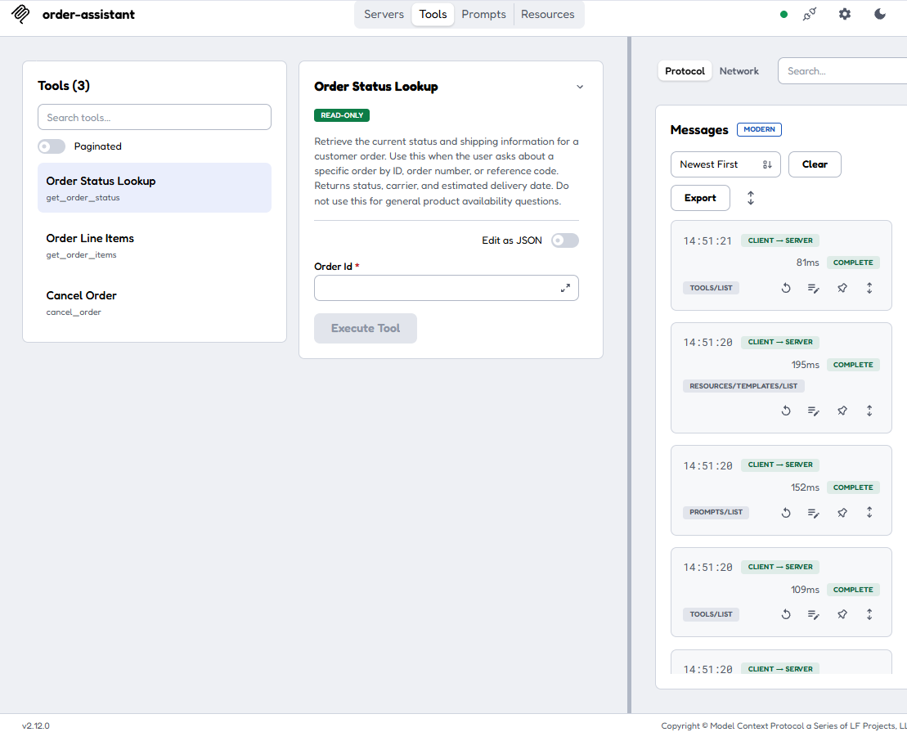

# MCP Order Assistant — Part 9 (Streamable HTTP)

The same TechNova order assistant from Part 5, moved from **stdio** to **Streamable HTTP** transport. The tools, resources, prompts, and protocol flow are identical. Only the transport changed.

This example runs on localhost to demonstrate the transition from stdio to Streamable HTTP. It is not a production deployment.

Authentication, authorization, and other production security controls are intentionally out of scope for this lab; MCP Parts 6–8 cover those concerns.

## Prerequisites

- Python **3.10+**
- A bash shell to run the `.sh` scripts (macOS/Linux Terminal, or Git Bash / WSL on Windows)

Note: on Windows, `mcp` may pull in `pywin32` automatically as a transitive dependency.

### Windows users

The `.sh` scripts require a bash shell. The easiest setup is often to open the repo in VS Code and set the integrated terminal to Git Bash or WSL. Options:

- **Git Bash** (recommended): install [Git for Windows](https://git-scm.com/download/win), open Git Bash, then run `bash run_server.sh` and `bash run_client.sh`
- **WSL**: open a WSL terminal, then run the same commands
- **Manual fallback** (no bash needed):
  ```
  python -m venv .venv
  .venv\Scripts\python -m pip install -r requirements.txt
  .venv\Scripts\python seed_data.py
  .venv\Scripts\python server_http.py       # Terminal 1
  .venv\Scripts\python client_http.py       # Terminal 2
  ```

## Project Structure

```
part9-order-assistant-streamable-http/
├── server.py              # Part 5 original (stdio) — unchanged
├── client.py              # Part 5 original (stdio) — unchanged
├── server_http.py         # NEW — Streamable HTTP server
├── client_http.py         # NEW — Streamable HTTP client
├── seed_data.py           # Data seeder — unchanged
├── data/
│   └── orders.json        # Seeded order data
├── images/
│   └── mcp-inspector-streamable-http.png
├── requirements.txt       # Dependencies (unchanged from Part 5)
├── run_server.sh          # One-command: venv + deps + seed + start server
├── run_client.sh          # One-command: run client (after server is up)
├── .env.example           # Environment config example
└── README.md
```

To keep the transition from Part 5 easy to compare, this example keeps separate stdio and Streamable HTTP server files instead of refactoring shared logic into a common module.

## Run (two terminals)

Unlike Part 5 (where the client launched the server as a subprocess), Part 9 uses HTTP — the server runs in its own terminal and the client connects to it over the network.

### Terminal 1 — Start the server

```bash
bash run_server.sh
```

This will:

- Create a repo-local virtual environment in `.venv/` and install pinned dependencies (first run only — skipped if `.venv/` already exists)
- Seed local JSON data to `./data/orders.json`
- Start the Streamable HTTP server on `http://127.0.0.1:8000/mcp`

Leave this running.

### Terminal 2 — Run the client

```bash
bash run_client.sh
```

This connects to the running server and runs the demo.

Note: `cancel_order` intentionally modifies `data/orders.json`. Re-run `bash run_server.sh` any time to reset state automatically (it re-seeds the JSON on every run).

## What you'll see

Terminal output that follows an **initialize → list → call** pattern:

- Step 1: initialize session (prints negotiated protocol version, server info, capability summary)
- Step 2: list tools/resources/prompts
- Step 3: call four tools and print full JSON results:
  - `get_order_status("ORD-10042")` — lookup a shipped order
  - `get_order_items("ORD-10042")` — get line items
  - `cancel_order("ORD-10099")` — cancel a processing order
  - `get_order_status("ORD-10099")` — confirm cancellation took effect

## Configuration

The server reads `DATA_PATH` from environment, defaulting to `./data/orders.json`.

An example env file is included:

- Copy `.env.example` to `.env` if you want to customize the data path.

## Endpoint Details

| Setting | Value | Source |
|---------|-------|--------|
| Host | `127.0.0.1` | FastMCP default |
| Port | `8000` | FastMCP default |
| Path | `/mcp` | FastMCP default (`streamable_http_path`) |
| Full URL | **`http://127.0.0.1:8000/mcp`** | Combined |

## Validate with MCP Inspector (optional)

With the server running, you can use MCP Inspector to verify the endpoint and browse its tools, resources, and prompts interactively.

In another terminal:

```bash
npx @modelcontextprotocol/inspector
```

This opens the Inspector UI in your browser. To connect:

1. Set **Transport Type** to **Streamable HTTP**
2. Enter `http://127.0.0.1:8000/mcp` as the URL
3. Click **Connect**

If the connection succeeds, you'll see the three TechNova tools — Order Status Lookup, Order Line Items, and Cancel Order — listed in the Tools tab.


*MCP Inspector connected over Streamable HTTP and listing the TechNova tools.*

## What Changed from Part 5

### Server (`server_http.py` vs `server.py`)

| Aspect | Part 5 | Part 9 |
|--------|--------|--------|
| Transport | `app.run(transport="stdio")` | `app.run(transport="streamable-http")` |
| Startup | Launched as subprocess by client | Runs as HTTP service on `127.0.0.1:8000` |
| Endpoint | stdin/stdout | `http://127.0.0.1:8000/mcp` |

Everything else — tools, resources, prompts, data helpers — is **identical**.

### Client (`client_http.py` vs `client.py`)

| Aspect | Part 5 | Part 9 |
|--------|--------|--------|
| Import | `stdio_client`, `StdioServerParameters` | `streamable_http_client` |
| Connection | `stdio_client(params)` (launches subprocess) | `streamable_http_client(url)` (connects to running server) |
| Session flow | initialize → list → call | initialize → list → call (**same**) |

### Dependencies

No new dependencies. The `mcp==1.26.0` package already includes Streamable HTTP support for both server and client. `uvicorn`, `starlette`, `httpx`, and `httpx-sse` were already in `requirements.txt`.

## Derived fields in prompts

The `summarize_order` prompt asks for fields like `item_count` and `total_amount`. These aren't stored directly in the JSON; they're meant to be derived from the order's `items`.

## Running the Part 5 stdio Demo

The original Part 5 files still work independently:

```bash
python seed_data.py
python client.py
```

The stdio client launches the server as a subprocess — no separate terminal needed.

## Companion Article

This repository accompanies
[Part 9: From Concepts to a Hands-On Example](https://aiinpracticehub.com/articles/from-concepts-to-a-hands-on-example/)
in the
[MCP in Practice series](https://aiinpracticehub.com/series/mcp/)
on [AI in Practice Hub](https://aiinpracticehub.com/).

## What This Example Shows

A developer who built the Part 5 stdio version should look at the diff and think:

> "The tools are identical. Only the transport changed."

The same applies to the client:

> "The session flow is identical. Only the connection method changed."

The protocol stays the same. Only the transport changes.
